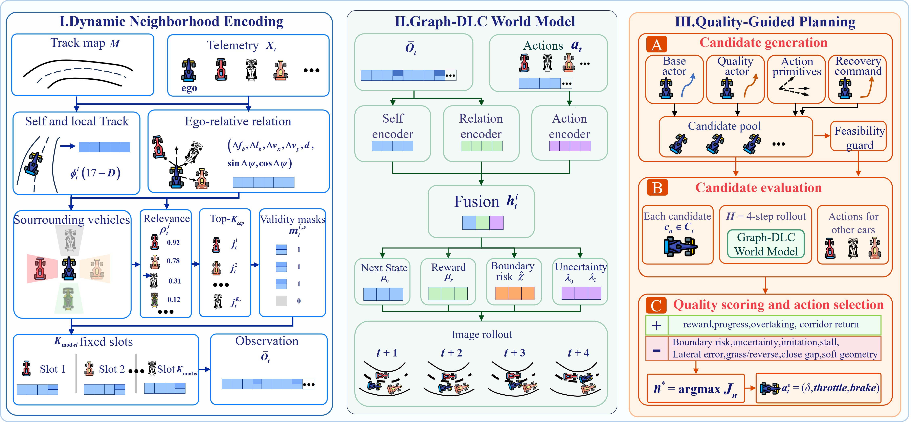

# DNQ-WM

**Dynamic-Neighbourhood Quality-Guided World-Model Planning (DNQ-WM)** is a
closed-loop overtaking controller for multi-vehicle autonomous racing. At every
decision step it rebuilds an ego-centric interaction graph, packs the retained
opponents into a fixed-width masked interface, rolls candidate ego actions
through an action-conditioned graph world model into short-horizon imagined
futures, ranks them by a quality-guided score, and commits only the first action
of the top-ranked candidate.

This repository releases the controller, the simulator, the training and
evaluation code, the frozen configurations and the trained checkpoints. The
per-case evaluation tables, the recorded trajectories and the simulation media
are not part of this release.



*Fig. 1. Overview of DNQ-WM. All three stages execute once per real decision
step, and only the first action of the selected candidate is committed.*

## Main results

Every method is evaluated on the same 48 cases: 12 tracks crossed with fleet
sizes of 4, 6, 8 and 10 vehicles. Every learned row is the mean over the draws of
its training protocol; the brackets give the range over those draws, not a
confidence interval. Bold marks the best value in a column, a higher value being
better except for the grass fraction and the mean lateral offset $|\ell|$, where
a lower value is better.

| Method | $P$ | $E_{\text{full}}$ | $E_{\text{race}}$ | Grass fraction | $\lvert\ell\rvert$ (hw) | Speed (m/s) | $t_{\text{pass}}$ | Rank gain |
|---|---:|---:|---:|---:|---:|---:|---:|---:|
| DNQ-WM | **45.8** [45, 47] | 20.2 [14, 26] | **11.0** [6, 15] | **0.157** [0.124, 0.199] | 1.11 [0.81, 1.38] | 15.9 | 281 | **4.88** [4.62, 5.02] |
| DNQ-WM (guard off) | 44.6 [38, 48] | **20.6** [17, 24] | 8.8 [3, 13] | 0.169 [0.127, 0.249] | 0.86 [0.80, 0.98] | 15.2 | 245 | 4.68 [4.15, 4.96] |
| Rule expert | 45 | 12 | 7 | 0.299 | 1.23 | 17.1 | 274 | 3.98 |
| DLC-JTO (matched) | 45.5 [45, 46] | 13.5 [11, 16] | 8.0 [6, 10] | 0.457 [0.418, 0.497] | 1.69 [1.41, 1.97] | 17.7 | 222 | 2.49 [1.79, 3.19] |
| PPO | 35.8 [28, 46] | 6.4 [0, 22] | 3.2 [0, 16] | 0.721 | 2.81 | **44.6** | **63** | 0.47 [0.19, 0.92] |
| SAC | 10.2 [0, 15] | 1.6 [0, 5] | 0 | 0.331 | 1.16 | 21.8 | 121 | 0.10 [0.00, 0.25] |
| TD3 | 8.2 [0, 13] | 2.2 [0, 5] | 0.2 [0, 1] | 0.245 | **0.80** | 20.8 | 166 | 0.11 [0.00, 0.21] |

$P$ is the number of cases completed out of 48, $E_{\text{full}}$ the strict
tier, $E_{\text{race}}$ the racing-rival tier, $|\ell|$ the mean absolute lateral
offset in road half widths, and $t_{\text{pass}}$ the mean number of steps to a
pass. In the twelve-track paired comparison DNQ-WM leads the DLC-JTO reference
on rank gain on all twelve tracks by $+2.39$ positions per case, 95 % interval
$[+1.90, +2.88]$, and the rule expert on ten tracks by $+0.90$,
$[+0.08, +1.68]$.

## Installation

Linux with Python 3.10, using the pinned environment:

```bash
conda env create -f environment.yml
conda activate dnq-wm
python -m pip install -e .
```

CPU execution is sufficient for the closed-loop evaluation used below; a
CUDA-capable GPU is faster. The commands read `cuda:0` by default, so add
`--device cpu` on a machine without a GPU. The simulator uses legacy Gym/Box2D
and may need system OpenGL libraries for rendering.

## Run one case

One track, four vehicles, the proposed controller and the rule-expert reference:

```bash
python code/scripts/run_tits_dynamic_graph_evaluation.py \
  --config reproduce/dnq_wm_release.json \
  --out-dir outputs/reproduction_run \
  --algorithms v6_runtime_dynamic_neighborhood_safe,rule_expert_gate \
  --num-agents 4 --seed 101 --max-steps 2200 --no-gif \
  --telemetry-version corrected_v2
```

## Compare all six methods

The released checkpoints of the DLC references were trained under the earlier
telemetry layout, so a single command that compares them with DNQ-WM passes
`--legacy-checkpoint-migration` as well:

```bash
python code/scripts/run_tits_dynamic_graph_evaluation.py \
  --config reproduce/dnq_wm_release.json \
  --out-dir outputs/reproduction_run \
  --algorithms v6_runtime_dynamic_neighborhood_safe,rule_expert_gate,dlc_joint_transition_observer,ppo_continuous,sac_continuous,td3_continuous \
  --num-agents 4 --seed 101 --max-steps 2200 --no-gif \
  --telemetry-version corrected_v2 --legacy-checkpoint-migration
```

Both commands are functional checks on single cases, not reruns of the 48-case
evaluation. Hardware, graphics drivers and floating-point libraries can shift
individual trajectories. The per-case metrics land in
`outputs/reproduction_run/tables/` and the comparison plot in
`outputs/reproduction_run/figures/`.

## Tests

```bash
cd code && PYTHONPATH=$PWD python -m unittest discover -s tests -p 'test_*.py'
```

## License

Software is released under the [MIT License](LICENSE), and the author-owned
configurations, figures and checkpoints under [CC BY 4.0](LICENSE-ASSETS.md);
see [ASSET_LICENSES.md](ASSET_LICENSES.md) for the scope. Do not use this
controller in real vehicles or safety-critical systems.
